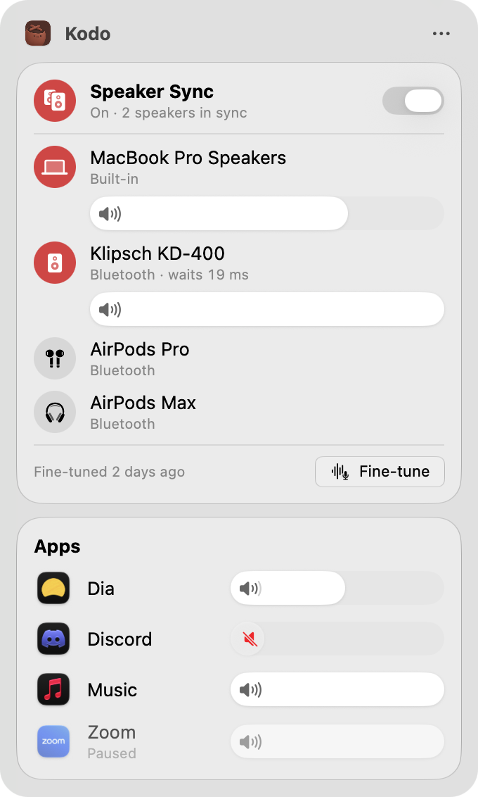
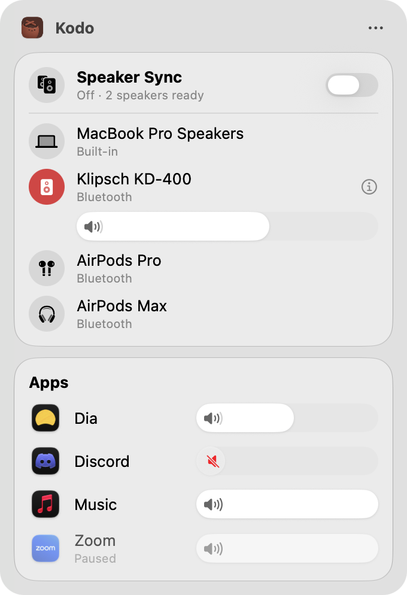
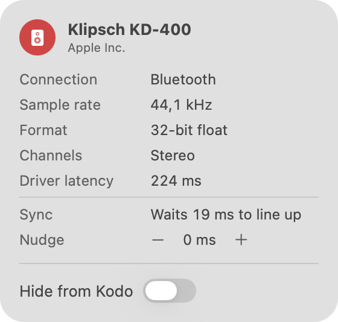

  

<h1 align="center">Kodo</h1>

  <b>Every speaker, one beat.</b> 
  Play your Mac through several speakers at once, in sync, and give every app its own volume.

  <a href="https://github.com/felitrejos/kodo/releases/latest"><b>Download for macOS</b></a>

  
  
  

  <picture>
    <source media="(prefers-color-scheme: dark)" srcset="assets/screenshots/menu-sync-dark.png">
    
  </picture>

Your Mac can already play to more than one speaker, but every Bluetooth speaker
runs a little late, so together they echo. Kodo lines them up. Turn on Speaker
Sync, pick your speakers, and the MacBook, the speaker on the shelf, and the
one across the room play as one.

It also puts a volume slider next to every app that's making sound, so the
video call stays loud while the music sits quietly underneath.

## Features

**Speakers that play together.** Speaker Sync sends everything your Mac plays
to all the speakers you choose at once, and keeps them in step over hours of
listening. The volume keys turn the whole group up and down together, keeping
each speaker's balance.

**Groups for every room.** Save sets of speakers, like "Living Room" or "Desk",
each with its own volumes and tuning, and switch between them in one click.
When a group's speaker turns back on, it rejoins by itself.

**Fine-tune for a perfect match.** Speakers line up on their own. For an exact
match, press Fine-tune: Kodo plays a short chirp through each speaker, listens
with your Mac's microphone, and corrects the difference. Turn on Keep in Sync
and Kodo checks again now and then by listening to the music itself, no chirps
needed.

**A volume for every app.** Every app playing sound gets its own slider, and
the speaker inside it mutes that app. Boost a quiet one up to 200%, or scroll
over any slider to adjust it. It works whether or not Speaker Sync is on.

**Send an app somewhere else.** Put the video call on your AirPods while the
music keeps playing on the speakers.

**Switch outputs in a click.** With Speaker Sync off, the speaker list works
like Control Center's: click a speaker to play through it, and slide to set its
volume.

**Know your devices.** Hover over a speaker and click ⓘ to see how it's
connected, its sample rate and format, and how Kodo keeps it in step. Hide the
devices you never use.

**Stays out of the way.** Kodo lives in the menu bar as a little taiko drum
that shows at a glance whether Sync is on. Hide the apps and devices you never
want to see, and Kodo remembers everything between launches.

  <picture>
    <source media="(prefers-color-scheme: dark)" srcset="assets/screenshots/menu-output-dark.png">
    
  </picture>
  &nbsp;
  <picture>
    <source media="(prefers-color-scheme: dark)" srcset="assets/screenshots/inspector-dark.png">
    
  </picture>

## Install

1. Download `Kodo-<version>.dmg` from the
   [latest release](https://github.com/felitrejos/kodo/releases/latest) and
   drag Kodo into Applications.
2. Open Kodo. The first time, macOS stops it from opening: go to
   **System Settings → Privacy & Security** and click **Open Anyway**.
3. Allow Kodo to record system audio when macOS asks.

Kodo needs macOS 26 or later.

## Getting started

1. Click the speaker icon in your menu bar.
2. Drag an app's slider to set its volume, or click the speaker inside it to
   mute it.
3. To play through several speakers, turn on **Speaker Sync** and click each
   speaker you want in the group.
4. Optionally, press **Fine-tune** with your Mac where you usually listen.

## Questions

**Do I have to fine-tune?**
No. Speakers in Sync line up on their own from what each one reports about
itself. Fine-tuning measures them for an exact match, which matters most with
cheaper Bluetooth speakers or a speaker on the other side of the room.

**Why does Kodo need to record system audio?**
That's how it captures what your apps play, so it can replay it at the right
volume and the right moment on each speaker. Nothing is saved or sent
anywhere; everything stays on your Mac.

**Why the microphone?**
To hear your speakers: during Fine-tune, and for a few seconds every ten
minutes while music plays if you turn on Keep in Sync. Kodo doesn't use the
microphone at any other time, and never keeps what it hears.

**Does it add delay?**
In a group, every speaker plays as late as the slowest one, usually a
Bluetooth speaker at about a quarter of a second. That's unnoticeable for
music, but videos can look slightly out of sync while a Bluetooth speaker is in
the group.

**What happens when I quit Kodo?**
Your Mac's audio goes straight back to normal.

## The name

鼓動 (*kodō*) means heartbeat. Kodō is also the taiko drumming group known for
playing in perfect unison, which is what Kodo asks of your speakers.

## Contributing

Bug reports and pull requests are welcome. See [CONTRIBUTING.md](CONTRIBUTING.md)
for building from source, how Kodo works under the hood, and how releases are
made.

## License

[MIT](LICENSE)
